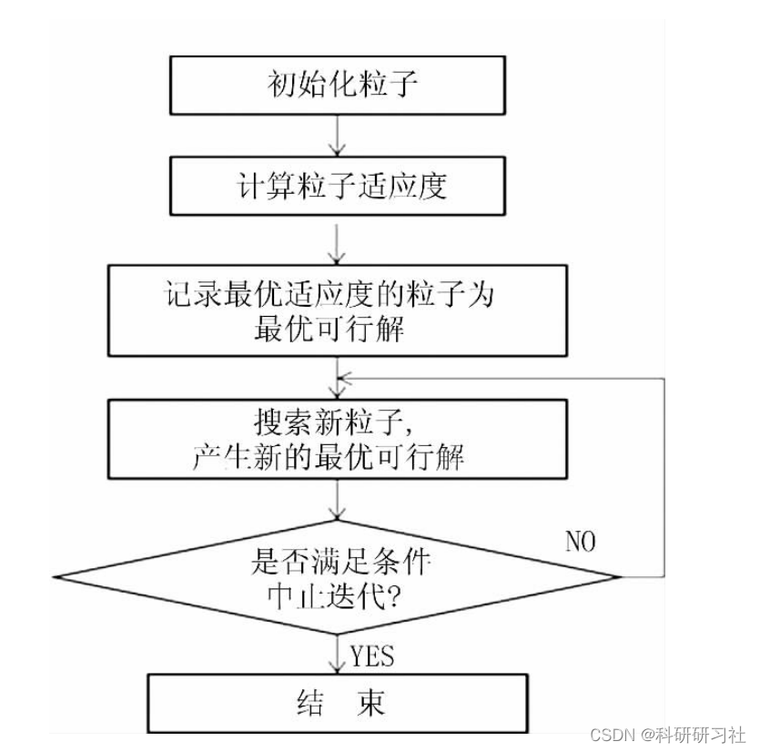
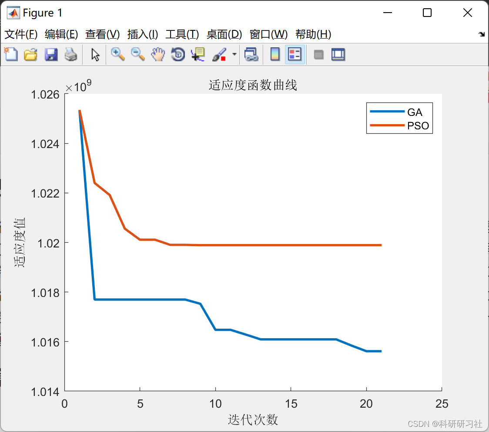
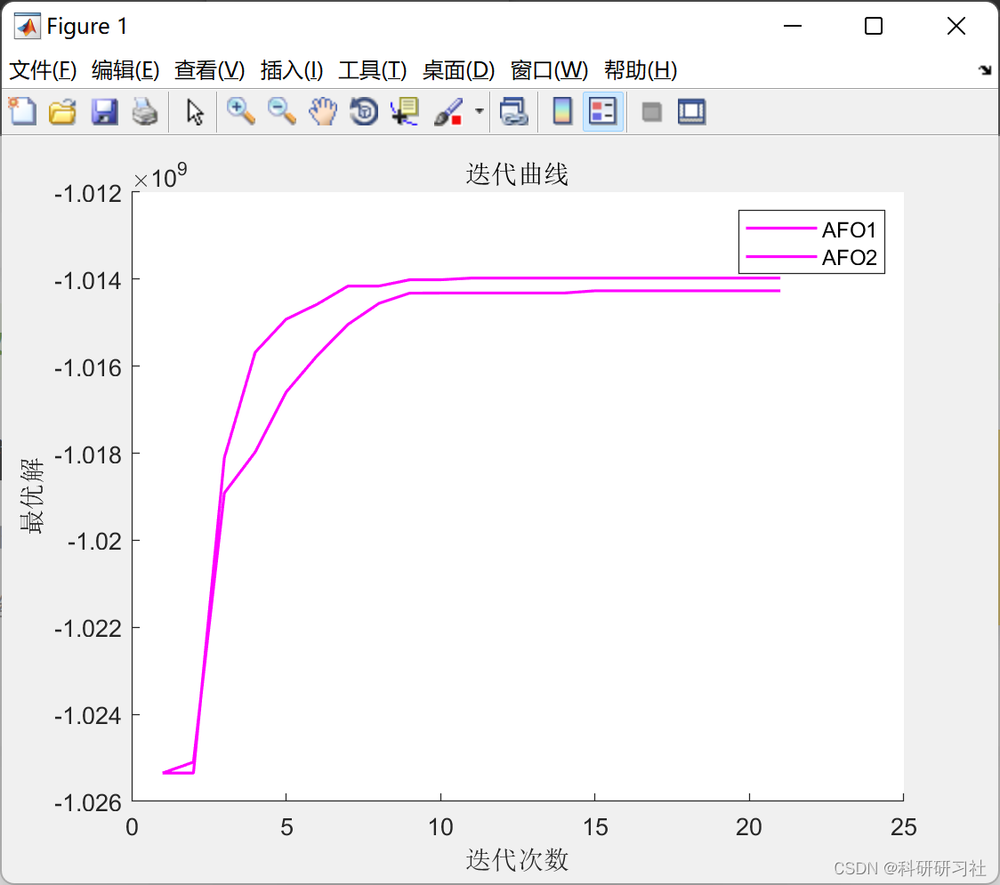

# Comparative Study of Power Flow Calculation Based on Genetic Algorithm and Particle Swarm Optimization (Matlab Code)

1. Overview of power system flow refers to the overall operational parameters in the system, including the power and current of each generator and load, the magnitude and phase of the bus voltages, the current, power, and losses through various lines and transformers, etc.
Flow calculation is an analysis system's steady-state operation based on the known grid structure and operating conditions. It is an important topic in the long-term research of electrical engineering.
This article explains the comparative study of flow calculations based on genetic algorithms and particle swarm optimization (Matlab code implementation).
2. The Particle Swarm Optimization algorithm is inspired by the model proposed by Russell Eberhart and James Kennedy, a Ph.D. in Electronic Engineering and a Ph.D. in Social Psychology, in 1995. The Particle Swarm Optimization algorithm simulates the behavior of birds finding food by sharing information during foraging. In this algorithm, the position of the bird's food is represented as a solution in the problem space, and the bird itself is represented as a "particle" with no mass or volume. The information sharing and mutual collaboration among the birds during foraging are equivalent to the information sharing and mutual cooperation between particles. While sharing information, particles adjust their movement direction and speed, thereby quickly searching for the optimal solution.
Editor
Figure 1: Particle Swarm Optimization Algorithm Process Diagram
3 Genetic Algorithms
Genetic algorithms have many advantages: (1) They can search globally, avoiding local optima easily; (2) The encoding is diverse, making genetic algorithms applicable to many problems; (3) They can perform parallel random searches, with the search range gradually narrowing down; (4) The fitness function is flexible, allowing both discrete and continuous values, and there are no restrictions on its differentiation; (5) Genetic algorithms can be used for complex problems, yielding reliable results; (6) They have strong compatibility and scalability, capable of integrating with many other algorithms. With the advancement of technology and in-depth research into various algorithms, it becomes increasingly evident that some algorithms have significant shortcomings. To avoid these flaws, integrating them with other algorithms to form new ones is a good approach. Genetic algorithms are one such cooperative algorithm.
4 Results of Power System Calculations
The results of power system calculations are edited as follows:
%% Comparative Study of Power Flow Calculation Based on Genetic Algorithm and Particle Swarm Optimization (Matlab Code)\nclc;\nclear;\nclose all;\n%% Random number seed\nrng('default')\nrng(1)\n%%\naddpath(genpath('matpower7.0'))\n%%\ndata.mpc=case9;\ndata.numBranch=length(data.mpc.branch(:,1));\ndata.distance=xlsread('Linear.xlsx',2);\ndata.Line=xlsread('Linear.xlsx',1);\ndata.numLine=length(data.Line(:,1));\ndata.base=100;\ndata.lamdaLoss=25; %Loss cost coefficient\n%% Algorithm parameter settings\ndim=data.numBranch;\n%%\nlb=zeros(1,dim);\nub=ones(1,dim);\nfobj=@aimFcn_1;\noption.lb=lb; % Lower limit\noption.ub=ub; % Maximum limit\noption.dim=dim;% Number of decision variables\nif length(option.lb)==1 % Determine if it is established, if it is established then proceed\n    option.lb=ones(1,option.dim)*option.lb; % Unify the length, each decision variable corresponds to one lb and ub.\n    option.ub=ones(1,option.dim)*option.ub; % Unify length, each decision variable corresponds to one lb and ub.\nend\noption.fobj=fobj;\noption.showIter=0;\n%% Algorithm parameter settings\n% Basic parameters\noption.numAgent=20;        % Initial number of solution individuals: the larger, the better\noption.maxIteration=20;    %Maximum number of iterations: the larger, the better\noption.popSize=option.numAgent;\noption.lenTS=option.numAgent*5;  %Forbidden length\n% Genetic Algorithm\noption.p1_GA=0.85;\noption.p2_GA=0.1;\n% Particle Swarm Algorithm\noption.w_pso=0.1;\noption.c1_pso=1;\noption.c2_pso=1;\nstr_legend=[{'GA'},{'PSO'}];\n%% Initialize the population of individuals\nx=ones(option.numAgent,option.dim);\ny=ones(option.numAgent,1);\nfor i=1:option.numAgent\n    x(i,:)=option.lb+rand(1,option.dim).*(option.ub-option.lb);\n    [y(i),~,x(i,:)]=option.fobj(x(i,:),option,data);\nend\n% Algorithm for solving\nrng(1)\n[bestY(1,:),bestX(1,:),recording(1)]=GA(x,y,option,data);\nrng(1)\n[bestY(2,:),bestX(2,:),recording(2)]=PSO(x,y,option,data);\n%%\nfigure\nhold on\nfor i=1:length(recording)\n    plot((recording(i).bestFit),'LineWidth',2)\nend\nxlabel('Iteration count')\nylabel('Fitness value')\nlegend(str_legend)\ntitle('Fitness function curve')\n\n%% Output result\nstr='GAAlgorithm optimization results'\n[~,result1]=option.fobj(bestX(1,:),option,data);\nstr='PSOAlgorithm optimization results'\n[~,result2]=option.fobj(bestX(2,:),option,data);\nstr='Random scheme'\n[~,result5]=option.fobj(bestX(2,:)*0+1,option,data);\n  
5. References
[1] Liu Jianhua. Basic Theory and Its Improvement of Particle Swarm Algorithm [D]. Changsha: Central South University, 2009.
[2] Sun Ruxiang. Research on the Hybrid of Particle Swarm and Genetic Algorithms [D]. Nanning: Guangxi University, 2014.
[3] Pang Feilong. Fuzzy Control System for Wire Feeding Based on Genetic Algorithm [D]. Beijing: China University of Geosciences, 2015.

## Images

<!-- PAYMENT_BLOCK -->

## Get this dataset

- Payment link (Stripe): [Buy now](https://buy.stripe.com/3cs8yP7sY87d0vu9AB)
- Payment QR code: 

<!-- /PAYMENT_BLOCK -->
